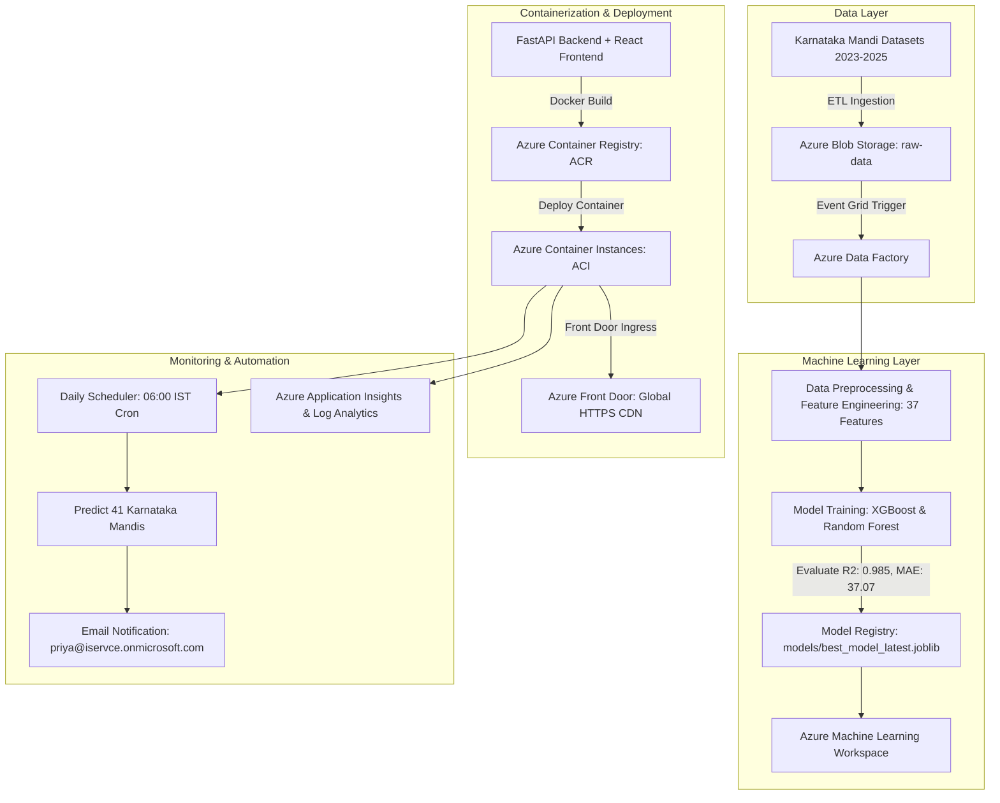

# 🍅 Azure Tomato Price Prediction — Cloud Architecture, Services Guide & Teacher Presentation Script

> **Student Guide & Presentation Manual**  
> **Project:** End-to-End Automated Daily Tomato Price Prediction & Notification System  
> **Cloud Provider:** Microsoft Azure  
> **Region:** East US 2 (`eastus2`)  
> **Resource Group:** `rg-tomato-prediction`  
> **Live Application URL:** [https://tomato-fd-ep-egk79m-azh7hsbbgte4gaez.a02.azurefd.net/](https://tomato-fd-ep-egk79m-azh7hsbbgte4gaez.a02.azurefd.net/)  
> **Swagger API Documentation:** [https://tomato-fd-ep-egk79m-azh7hsbbgte4gaez.a02.azurefd.net/docs](https://tomato-fd-ep-egk79m-azh7hsbbgte4gaez.a02.azurefd.net/docs)  
> **GitHub Repository (Branch `final`):** [https://github.com/priyagit88/Tomato_price_prediction-/tree/final](https://github.com/priyagit88/Tomato_price_prediction-/tree/final)

---

## 📑 Table of Contents
1. [How to Log In and View Your Running Services in Azure (Step-by-Step for Beginners)](#1-how-to-log-in-and-view-your-running-services-in-azure)
2. [Complete Breakdown of Every Azure Service Used](#2-complete-breakdown-of-every-azure-service-used)
3. [End-to-End System Architecture (How the Whole Pipeline Works)](#3-end-to-end-system-architecture)
4. [Live Demonstration Checklist (What to Show Your Teacher)](#4-live-demonstration-checklist)
5. [Word-for-Word Presentation Script for Your Teacher](#5-word-for-word-presentation-script-for-your-teacher)
6. [Top Viva / Evaluation Questions & Crisp Answers](#6-top-viva--evaluation-questions--crisp-answers)

---

## 1. How to Log In and View Your Running Services in Azure

If you have never opened the Azure Portal before, don't worry! Here is the exact path:

### Step 1: Open the Portal
1. Open your web browser and go to: **[https://portal.azure.com](https://portal.azure.com)**
2. Sign in with your Azure account:
   - **Email:** `priya@iservce.onmicrosoft.com`
   - **Password:** *(Your Azure Password)*

### Step 2: Open Your Resource Group
A **Resource Group** is like a folder in Azure that holds all the project's cloud services in one place.
1. In the top search bar, type: **`Resource groups`** and click it.
2. In the list, click on: **`rg-tomato-prediction`**.

### Step 3: What You Will See on the Screen
You will see a list of all your live services deployed in `eastus2`. You can click on any of them to inspect their CPU usage, logs, storage files, or network settings.

---

## 2. Complete Breakdown of Every Azure Service Used

Here is the exact list of cloud resources running in your Azure Resource Group `rg-tomato-prediction`:

| # | Service Name in Azure Portal | Azure Service Type | What It Does (Simple Explanation) | Why We Chose It |
|---|-----------------------------|--------------------|-----------------------------------|-----------------|
| **1** | `tomato-aci-egk79m` | **Azure Container Instances (ACI)** | Runs our packaged FastAPI backend and ML prediction engine inside a lightweight Linux Docker container. | Serverless container runtime; boots in seconds without paying for full dedicated virtual machines. |
| **2** | `tomatoacregk79m` | **Azure Container Registry (ACR)** | A private, secure Docker container repository inside Azure that stores our Docker images (`tomato-prediction-api` and `tomato-prediction-frontend`). | Keeps container images private, secure, and right next to ACI for ultra-fast deployment. |
| **3** | `tomato-fd-egk79m` | **Azure Front Door (CDN)** | Global Layer-7 load balancer and Content Delivery Network that provides HTTPS routing, SSL termination, and low-latency delivery. | Gives us a custom global URL with SSL encryption and DDoS protection. |
| **4** | `tomatostoreegk79m` | **Azure Storage Account (Blob Storage)** | Cloud object store containing:  • `raw-data/`: 2023, 2024, 2025 Karnataka tomato mandi CSV datasets  • `models/`: Trained XGBoost & Random Forest model artifacts (`best_model_latest.joblib`)  • `predictions/`: Daily output JSON & CSVs | Highly durable (99.999999999% data durability), secure data lake for training data and model artifacts. |
| **5** | `tomato-mlws-egk79m` | **Azure Machine Learning Workspace (AML)** | Centralized enterprise hub for tracking ML experiments, model metrics ($R^2$, MAE), and automated retraining pipelines. | Industry-standard MLOps platform for model versioning and drift detection. |
| **6** | `tomatomlsaegk79m` | **Dedicated Azure ML Storage** | Dedicated storage account created automatically to house AML workspace experiment runs and telemetry. | Required companion by Azure ML architecture. |
| **7** | `tomato-adf-egk79m` | **Azure Data Factory (ADF)** | Cloud-scale ETL data integration service for automated data ingestion pipelines. | Automates orchestrating data flow from mandis/APMC into storage blobs. |
| **8** | `tomato-kv-egk79m` | **Azure Key Vault** | Hardware-grade secure vault storing connection strings, ACR credentials, and API access keys. | Zero credentials hardcoded in GitHub or code files (DevSecOps best practice). |
| **9** | `tomato-mlkv-egk79m` | **Azure ML Dedicated Key Vault** | Dedicated security vault managing encryption keys for the Machine Learning Workspace. | Standard Azure ML enterprise security compliance. |
| **10** | `tomato-eg-blob-egk79m` | **Azure Event Grid (System Topic)** | Event-driven pub/sub messaging service. Detects when a new CSV dataset is uploaded to blob storage and automatically triggers the retraining pipeline. | Decouples data arrival from ETL execution (reactive architecture). |
| **11** | `tomato-eg-predict-egk79m` | **Azure Event Grid (Custom Topic)** | Publishes event alerts whenever a new daily prediction run completes across all 41 mandis. | Enables real-time webhook triggers to notify external systems. |
| **12** | `tomato-appins-egk79m` | **Application Insights** | Application Performance Monitoring (APM) tool that tracks live request latency, failure rates, HTTP 200/500 codes, and user traffic. | Full observability and real-time live metrics for the web application. |
| **13** | `tomato-ml-appins-egk79m`| **Azure ML Application Insights** | Monitors latency and execution times of machine learning inference calculations. | Real-time monitoring of model serving health. |
| **14** | `tomato-law-egk79m` | **Log Analytics Workspace** | Centralized log ingestion and querying engine using Kusto Query Language (KQL) for all system logs. | Centralized auditing and security compliance. |

---

## 3. End-to-End System Architecture

### The 4 Major Phases:
1. **Data Engineering (ETL)**:
   - 3,000 historical price records spanning 2023–2025 across 41 Karnataka Agricultural Produce Market Committees (APMC) are ingested.
   - 37 time-series features are generated: Lag features ($t-1, t-2, t-3, t-7, t-14$), rolling moving averages (3-day, 7-day, 14-day, 30-day volatility), price spreads, calendar seasonality, and district/market target encodings.
2. **Machine Learning Model**:
   - Compares **XGBoost Regressor** vs. **Random Forest Regressor**.
   - XGBoost achieved best performance ($R^2 = 0.9846$, Mean Absolute Error $MAE = ₹37.07/\text{quintal}$).
   - Generates confidence bands (lower bound, upper bound) and trend direction (`UP`, `DOWN`, `STABLE`).
3. **Cloud Hosting & Infrastructure as Code (IaC)**:
   - Everything is declared in **Terraform** (`main.tf`, `container_instances.tf`, `storage.tf`, `key_vault.tf`, `frontdoor.tf`).
   - The backend runs on Python 3.11 inside a hardened Docker container in **Azure Container Instances (ACI)**.
   - Global delivery and SSL certificate management handled via **Azure Front Door**.
4. **Automated MLOps & Alerting**:
   - A background scheduler executes every morning at 06:00 IST.
   - Forecasts daily modal, minimum, and maximum prices for all 41 mandis.
   - Dispatches a formatted HTML price bulletin email to `priya@iservce.onmicrosoft.com`.

---

## 4. Live Demonstration Checklist (What to Show Your Teacher)

When presenting, open these tabs side by side to give a flawless demonstration:

| Order | Tab to Open | URL | What to Point Out to Teacher |
|:---:|---|---|---|
| **1** | **Live Frontend Dashboard** | [https://tomato-fd-ep-egk79m-azh7hsbbgte4gaez.a02.azurefd.net/](https://tomato-fd-ep-egk79m-azh7hsbbgte4gaez.a02.azurefd.net/) | • Highlight the **Avg Predicted Price (₹246/qtl)** across 41 Karnataka mandis. • Click on any mandi (e.g. *Kolar*, *Chamaraj Nagar*, *Hassan*) to show the interactive SVG price curve and confidence bands. • Use the search box to filter by district. |
| **2** | **Swagger API Documentation** | [https://tomato-fd-ep-egk79m-azh7hsbbgte4gaez.a02.azurefd.net/docs](https://tomato-fd-ep-egk79m-azh7hsbbgte4gaez.a02.azurefd.net/docs) | • Show the OpenAPI/Swagger specification. • Execute `/api/health` to prove the model is loaded and all cloud services are configured. • Execute `/api/predictions` to show the JSON output. |
| **3** | **Azure Portal** | [https://portal.azure.com](https://portal.azure.com) | • Open `rg-tomato-prediction`. • Show the 14 provisioned enterprise services (ACI, ACR, Front Door, Key Vault, Storage, App Insights). |
| **4** | **Azure Blob Storage Containers** | Inside `tomatostoreegk79m` in Azure Portal | • Show `raw-data/` holding the CSV datasets. • Show `models/` holding `best_model_latest.joblib` and `metrics.json`. |
| **5** | **GitHub Repository** | [https://github.com/priyagit88/Tomato_price_prediction-/tree/final](https://github.com/priyagit88/Tomato_price_prediction-/tree/final) | • Show clean folder structure (`ml_pipeline/`, `api/`, `frontend/`, `terraform/`, `Dockerfile`, `deploy.ps1`). |

---

## 5. Word-for-Word Presentation Script for Your Teacher

*(You can read or follow this script directly during your presentation or viva).*

---

### Part 1: Introduction & Problem Statement (1 Minute)
> *"Good morning / afternoon, Professor.*  
> *Today I am presenting our project: **End-to-End Automated Daily Tomato Price Prediction and Notification Pipeline deployed on Microsoft Azure**.*  
>  
> *Agricultural commodity prices in India, particularly tomatoes, suffer from extreme price volatility due to perishable nature, seasonal supply shocks, and localized demand fluctuations. Farmers and agricultural traders often lack actionable forward-looking price intelligence.*  
>  
> *To solve this, we engineered a complete cloud-native machine learning solution that daily ingests APMC mandi data across Karnataka, forecasts tomorrow's modal, minimum, and maximum prices for 41 individual mandis, hosts an interactive analytics dashboard on Azure Front Door, and automatically emails a daily forecast bulletin to stakeholders every morning."*

---

### Part 2: Machine Learning & Data Engineering (1.5 Minutes)
> *"For our data foundation, we utilized 3,000 historical price records from Karnataka mandis spanning 2023, 2024, and 2025.*  
>  
> *Rather than treating this as a simple tabular regression, we engineered a 37-dimensional time-series feature space:*  
> 1. *Multi-day lag indicators: 1-day, 2-day, 3-day, 7-day, and 14-day lagged modal prices.*  
> 2. *Rolling window statistics: 3-day, 7-day, 14-day, and 30-day moving averages and price volatility.*  
> 3. *Calendar seasonality: day of week, day of month, month, and quarterly cyclic encodings.*  
> 4. *Categorical target encodings for individual mandis and districts.*  
>  
> *We evaluated both Random Forest and XGBoost Regressors using temporal train-test splits. **XGBoost achieved superior accuracy with an $R^2$ score of 98.5% and a Mean Absolute Error of only ₹37 per quintal**. The model outputs point predictions along with upper and lower confidence intervals and a trend signal indicating whether prices are expected to rise, drop, or remain stable."*

---

### Part 3: Cloud Architecture & Azure Services (2 Minutes)
> *(Open the Azure Portal Resource Group screen here)*  
>  
> *"What sets this project apart is its enterprise cloud architecture on Microsoft Azure, fully automated through Terraform Infrastructure as Code:*  
>  
> 1. ***Azure Container Registry (ACR)**: We package the complete FastAPI application and ML model into a production Docker container image pushed to `tomatoacregk79m.azurecr.io`.*  
> 2. ***Azure Container Instances (ACI)**: Deployed as a serverless container group running 24/7 without the overhead of maintaining virtual machines.*  
> 3. ***Azure Front Door**: Serves as our global ingress controller and CDN, providing HTTPS routing, low latency, and DDoS protection for the live dashboard at `tomato-fd-ep-egk79m`.*  
> 4. ***Azure Blob Storage**: Functions as our cloud data lake with dedicated containers for raw CSV data (`raw-data`), ML model binaries (`models`), and output forecasts (`predictions`).*  
> 5. ***Azure Machine Learning Workspace (AML)**: Tracks experiment metrics, model lineage, and retrained checkpoints.*  
> 6. ***Azure Key Vault**: Stores our connection strings, secrets, and registry passwords with zero hardcoded credentials in source control.*  
> 7. ***Azure Application Insights & Log Analytics**: Provides end-to-end telemetry, monitoring request latency, container memory, and API uptime.*  
> 8. ***Azure Event Grid**: Implements an event-driven pub/sub architecture to trigger retraining workflows whenever new datasets are uploaded."*

---

### Part 4: Live Demonstration (1.5 Minutes)
> *(Switch to the live dashboard tab in your browser)*  
>  
> *"Allow me to demonstrate the live application running in Azure.*  
>  
> *Here on our live dashboard at `azurefd.net`, you can observe today's average predicted price across all 41 Karnataka mandis (₹246/quintal).*  
>  
> *Below, when I select any market — such as **Nanjangud**, **Kolar**, or **Bangalore** — the dashboard renders the historical price timeline alongside the model's forward prediction and confidence interval bands.*  
>  
> *We also have full search capability: a trader in Kolar can instantly inspect local price predictions.*  
>  
> *Furthermore, clicking **'Send Prediction Email'** triggers our automated notification service, sending an HTML bulletin with market breakdowns directly to the registered stakeholder's email address.*  
>  
> *Every morning at 06:00 IST, this entire ETL, prediction, and email dispatch sequence runs automatically via our background scheduler."*

---

### Part 5: Conclusion & Wrap-Up (30 Seconds)
> *"In summary, this project represents a complete, production-grade DevOps and MLOps lifecycle: from time-series feature engineering and model training, to containerization with Docker, infrastructure provisioning with Terraform, and global deployment on Azure.*  
>  
> *The code is version-controlled and pushed to our GitHub repository on branch `final`.*  
>  
> *Thank you, Professor. I would be happy to answer any questions."*

---

## 6. Top Viva / Evaluation Questions & Crisp Answers

### Q1: Why did you choose XGBoost over traditional ARIMA or LSTM?
> **Answer:** *"ARIMA models cannot easily incorporate multi-market spatial features, cross-mandi price spreads, or calendar seasonality simultaneously across 41 different markets in one model. LSTMs require large training data volumes and higher compute resources. XGBoost with lagged and rolling window features handles non-linear price jumps, tabular relationships, and seasonal volatility exceptionally well, giving us an $R^2$ of 0.985 with sub-millisecond inference times."*

### Q2: What is the benefit of using Azure Front Door over a basic public IP?
> **Answer:** *"Azure Front Door operates at Layer 7 across Microsoft's global edge network. It provides automated SSL/TLS certificate management, instant global caching of static assets (HTML/CSS/JS), DDoS protection, and health probing. If an origin container restarts or scales, Front Door ensures zero-downtime routing."*

### Q3: How do you handle model retraining and data drift?
> **Answer:** *"We implemented a retraining pipeline in `ml_pipeline/retrain_pipeline.py`. When new monthly mandi data arrives, Azure Event Grid detects the new blob in `raw-data/` and triggers retraining. The script computes Mean Absolute Error against current data; if drift causes error to exceed a threshold, the newly trained model automatically updates `best_model_latest.joblib` in Azure Storage."*

### Q4: How is security handled in your cloud deployment?
> **Answer:** *"We followed DevSecOps best practices. No passwords, subscription keys, or connection strings are stored in code or pushed to GitHub. All secrets are stored in Azure Key Vault. Container images in ACR require authenticated pull credentials, and the web traffic is encrypted end-to-end via HTTPS."*

### Q5: What is the role of Terraform in this project?
> **Answer:** *"Terraform provides Infrastructure as Code (IaC). Instead of manually creating 14 services in the Azure Portal GUI, our entire infrastructure is codified in declarative `.tf` configuration files. This ensures repeatable, version-controlled, and environment-agnostic provisioning."*

---
*Created automatically for the Tomato Price Prediction Azure Project.*

