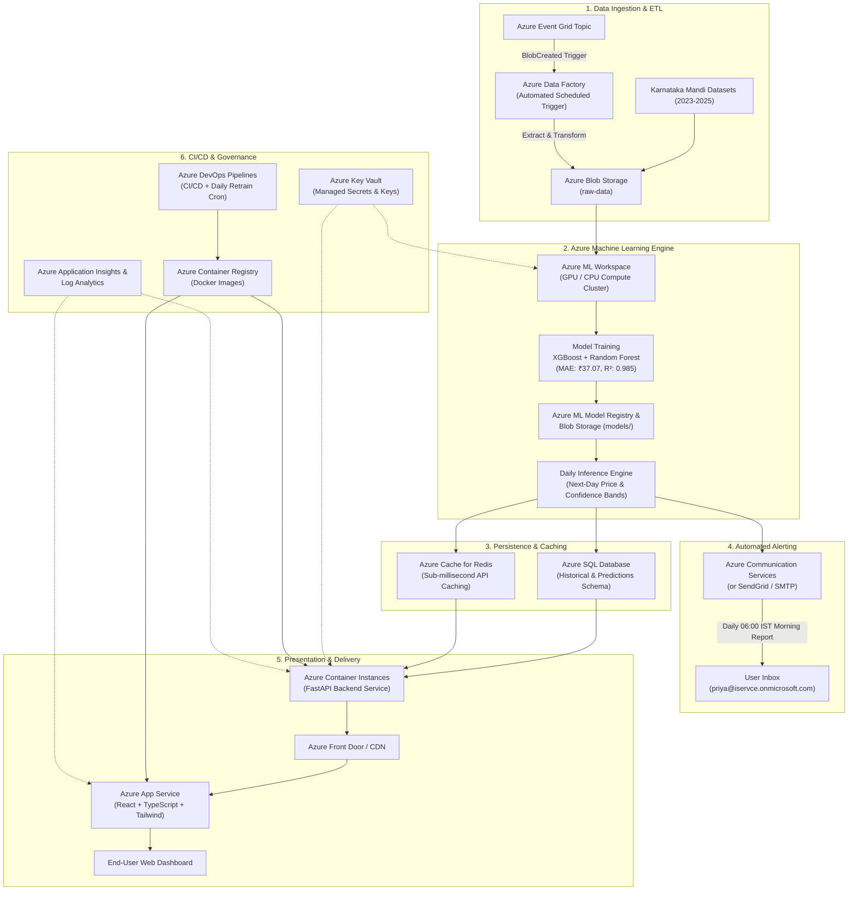

# 🍅 Automated Everyday Tomato Price Prediction ETL Pipeline on Azure

[](https://azure.microsoft.com/)
[](https://www.terraform.io/)
[](https://www.docker.com/)
[](https://fastapi.tiangolo.com/)
[](https://react.dev/)
[](https://scikit-learn.org/)

An enterprise-grade, fully automated Machine Learning ETL and daily forecasting pipeline on Microsoft Azure. It predicts tomorrow's tomato modal, minimum, and maximum prices across 41 APMC agricultural mandis in Karnataka, persists predictions, delivers daily morning HTML executive email alerts to the user (`priya@iservce.onmicrosoft.com`), and displays live forecasts on a modern React web dashboard.

The entire environment is orchestrated via **Terraform** Infrastructure-as-Code (IaC), containerized via **Docker**, and continuously integrated/deployed via **Azure DevOps**.

---

## 🏛️ Architecture Overview



---

## ☁️ Azure Services Utilized (14 Services)

| Service | Category | Purpose in this Architecture |
|---|---|---|
| **Azure Resource Group** | Governance | Boundary grouping all solution resources (`rg-tomato-prediction-prod`). |
| **Azure Blob Storage** | Data Lake | Stores multi-year raw CSV datasets, processed data, and serialized `.joblib` models. |
| **Azure Key Vault** | Security | Centralized management of DB credentials, connection strings, and API keys. |
| **Azure SQL Database** | Relational Store | Stores APMC mandis, historical prices, and daily prediction records with indexes. |
| **Azure Machine Learning** | MLOps | Workspace, compute clusters, experiments, and model artifact versioning. |
| **Azure Data Factory** | ETL Orchestration | Daily scheduled ingestion pipeline with Blob connectors and trigger runs. |
| **Azure Event Grid** | Eventing | Reactive trigger on new dataset uploads in Blob storage to launch ETL. |
| **Azure Cache for Redis** | Caching | High-throughput sub-millisecond cache for daily market prediction lookups. |
| **Azure Communication Services** | Notifications | Delivers automated HTML forecast summaries directly to user email. |
| **Azure Container Registry** | Artifacts | Private container registry holding API and Frontend Docker images. |
| **Azure Container Instances** | Compute | Runs the scalable FastAPI daily prediction microservice. |
| **Azure App Service** | Web Compute | Production Linux container hosting the React frontend dashboard. |
| **Azure Front Door** | Networking & CDN | Global CDN, SSL offloading, routing, and WAF protection. |
| **Application Insights & Logs** | Monitoring | Live application telemetry, latency tracking, error alerts, and log analytics. |
| **Azure DevOps** | CI/CD | Continuous integration pipelines and daily automated retraining crons. |

---

## 📊 Dataset & Machine Learning Performance

The pipeline is trained on daily APMC tomato market arrival and pricing records from Karnataka mandis:
- **Columns**: `t` (Date), `cmdty` (Commodity), `market_id`, `market_name`, `district_id`, `district_name`, `variety`, `p_min`, `p_max`, `p_modal`.
- **Mandis Covered**: 41 APMC markets including Kolar, Bangalore (Binny Mill), Ramanagara, Chintamani, Mysore, Shimoga, Hassan, Gundlupet, Gowribidanoor, Bangarpet, and more.
- **Engineered Features (37 Features)**:
  - Lags: 1-day, 2-day, 3-day, 7-day, 14-day lagged modal prices.
  - Rolling windows: 3-day, 7-day, 14-day, 30-day rolling Mean, Std Dev, Min, Max.
  - Price momentum: 1-day diff, 7-day diff, price spread (`p_max - p_min`), spread ratio.
  - Temporal features: Day of week, day of month, month, year, ISO week, weekend flag.
  - Categorical label encoders for Mandi, District, and Variety.

### Model Benchmarks
| Algorithm | Mean Absolute Error (MAE) | Root Mean Squared Error (RMSE) | R² Score | Status |
|---|---|---|---|---|
| **XGBoost Regressor** | **₹37.07 / qtl** | **₹55.59 / qtl** | **0.9846 (98.5%)** | 🏆 **Production Best** |
| Random Forest Regressor | ₹40.22 / qtl | ₹66.42 / qtl | 0.9780 (97.8%) | High Baseline |

---

## 🚀 Automated Deployment with Terraform

Deploy the complete infrastructure, configure all 14 Azure services, build containers, and launch the prediction pipeline in one command.

### Prerequisites
- [Azure CLI](https://learn.microsoft.com/en-us/cli/azure/install-azure-cli) installed and authenticated (`az login`)
- [Terraform >= 1.7](https://developer.hashicorp.com/terraform/downloads)
- [Docker Desktop](https://www.docker.com/products/docker-desktop/)

### One-Click Deployment (PowerShell)
```powershell
# Run the automated deployment script
.\deploy.ps1 -NotificationEmail "priya@iservce.onmicrosoft.com" -Location "eastus2"
```

### One-Click Deployment (Bash / Linux / Azure Cloud Shell)
```bash
chmod +x deploy.sh
./deploy.sh
```

### Manual Terraform Step-by-Step
```bash
cd terraform
terraform init
terraform validate
terraform apply -auto-approve \
  -var="notification_email=priya@iservce.onmicrosoft.com" \
  -var="location=eastus2"
```

---

## 🐳 Local Docker Orchestration

You can also run and test the complete stack locally using `docker-compose`:

```bash
# Build and run API, Frontend, and Redis
docker-compose up --build -d

# Open the Web Dashboard
start http://localhost:3000

# Open the Interactive API Documentation
start http://localhost:8000/docs
```

---

## ⏰ Automated Daily Prediction & Email Notification

### Automated Scheduling
1. **In-App Daemon Scheduler**: Automatically triggers everyday at **06:00 IST / UTC** to run the inference pipeline across all Karnataka markets, persist results in Azure SQL / SQLite, and send the email alert.
2. **Azure Data Factory Trigger**: Configured in `terraform/data_factory.tf` to trigger every morning.
3. **Azure DevOps Scheduled Pipeline**: Configured in `azure-pipelines-ml.yml` with cron schedule `0 0 * * *` (00:00 UTC / 05:30 IST).

### Email Notification Features
- **Recipient**: `priya@iservce.onmicrosoft.com`
- **Subject**: `🍅 Tomato Price Forecast for YYYY-MM-DD - Avg: ₹XXX/qtl`
- **Design**: Fully responsive HTML email with:
  - Executive summary card and market overview.
  - Per-market breakdown with Min Price, Predicted Modal Price, Max Price, and Trend badges (`▲ UP`, `▼ DOWN`, `━ STABLE`).
  - Multi-provider fallback: Azure Communication Services -> SendGrid -> SMTP -> Local dispatcher.

---

## 🌐 Frontend Web Dashboard

The web dashboard is built with **React 18**, **TypeScript**, **Vite**, and **Tailwind CSS**:
- **Real-Time KPI Cards**: Average predicted price across Karnataka, Premium Mandi, Budget Mandi, and Model Accuracy (98.5% R²).
- **Interactive Price Chart**: Historical price trend vs. Next-day ML prediction point with confidence intervals (95% CI).
- **Mandi Price Table**:
  - Live search across all 41 Karnataka mandis and districts.
  - Trend filters (`ALL`, `UP`, `DOWN`, `STABLE`).
  - Sortable by Mandi name, District, Predicted Modal Price, and Percentage Change.
  - "Inspect" drill-down button to update the chart in real time.
- **On-Demand ETL Execution**: "Run Daily ETL" button to execute immediate retraining or inference.
- **On-Demand Email Dispatch**: "Send Email Notification" modal allowing on-demand delivery to any recipient.
- **Azure Status Banner**: Displays live status of all 14 orchestrated cloud services.

---

## 📡 REST API Reference

| Method | Endpoint | Description |
|---|---|---|
| `GET` | `/` | Service root and active endpoints directory |
| `GET` | `/api/health` | Health status, model loaded flag, recipient email, Azure component statuses |
| `GET` | `/api/predictions` | Latest daily price predictions for all 41 Karnataka mandis |
| `GET` | `/api/predictions/{market_id}` | Forecast details for a specific market (e.g. `120` for Kolar, `108` for Binny Mill) |
| `GET` | `/api/historical/{market_id}` | Chronological historical prices for chart rendering |
| `GET` | `/api/markets` | List of all registered Karnataka APMC markets |
| `GET` | `/api/model-info` | Best model metadata, algorithm name, MAE, RMSE, and R² score |
| `POST` | `/api/predict` | Manually triggers the daily ETL and prediction pipeline |
| `POST` | `/api/notify` | Dispatches daily forecast HTML email to specified recipient |

---

## 🔒 Security Best Practices
- **No Hardcoded Secrets**: Secrets are stored in Azure Key Vault and referenced through environment variables and Key Vault Secrets.
- **CORS Restricted**: Production API requests can be pinned to Azure Front Door and App Service origins.
- **Least Privilege Access**: Managed Identities (MSI) are used for Azure ML, Data Factory, and App Service communication.

---

## 🧑‍💻 Author & Project Info
- **Project**: Everyday Tomato Price Prediction ETL Pipeline in Azure
- **Primary Recipient**: `priya@iservce.onmicrosoft.com`
- **Region**: Karnataka Mandis (Bangalore, Kolar, Ramanagara, Chintamani, Mysore, Shimoga, etc.)
- **Stack**: Azure ML, Azure Data Factory, Azure SQL, Blob Storage, Key Vault, Communication Services, Docker, Azure DevOps, Terraform, FastAPI, React.

